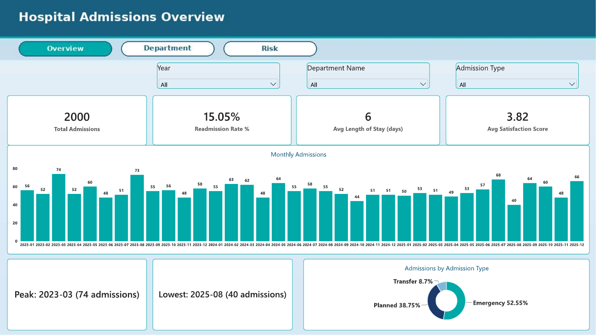
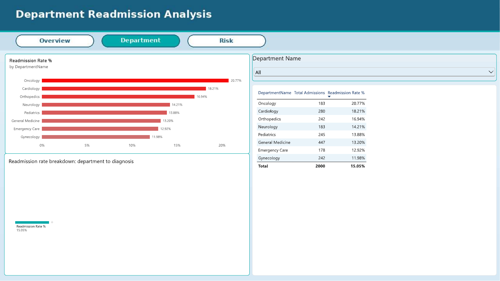
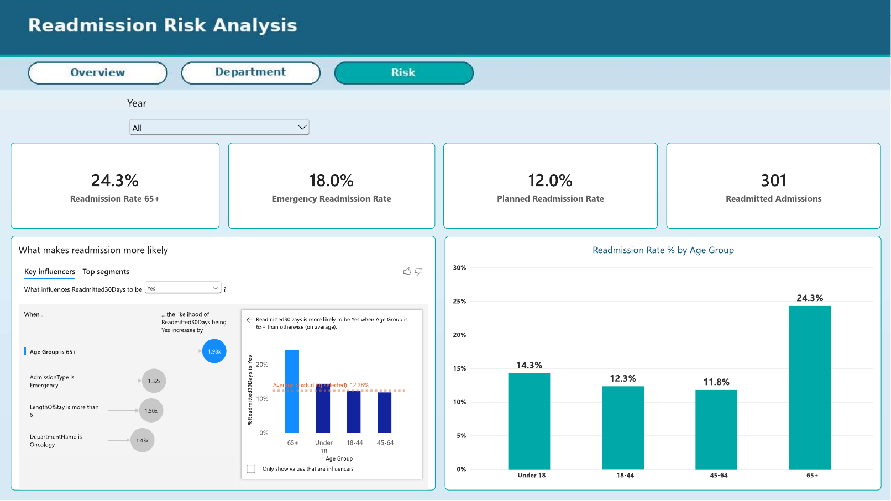

# Hospital Admissions & Patient Analysis Dashboard

An interactive Power BI dashboard that analyzes hospital admission and patient data to show admission trends, patient demographics, and department-wise activity.

## Dataset
- **Source:** Self-prepared sample dataset created by the author for this project. It contains no real patient records.
- **Format:** Excel workbook (`Hospital_Dataset.xlsx`) with 4 sheets
- **Sheets:**
  - **Admissions:** 2,000 rows after removing 30 duplicate rows (2,030 originally), 14 columns
  - **Patients:** 1,200 rows, 7 columns
  - **Doctors:** 40 rows, 5 columns
  - **Departments:** 8 rows, 4 columns
 
## Tools Used
- **Power BI** (data modeling, DAX, visualization)

## Steps
1. **Data loading:**     imported the CSV dataset into Power BI.
2. **Data cleaning:**    removed duplicates, handled missing values, fixed date formats.
3. **Data modeling:**    created relationships between tables, added a date table.
4. **DAX measures:**     total admissions, average length of stay, admissions by department.
5. **Dashboard design:** built visuals with slicers and filters for interactive exploration.

## Dashboard Preview

## Key Insights
- Total of 2,000 admissions with an overall readmission rate of 15.05% (301 readmitted admissions).
- Oncology has the highest department readmission rate at 20.77%, while Gynecology has the lowest at 11.98%.
- Patients aged 65 and over have a 24.3% readmission rate, about double the 11.8% for ages 45 to 64. Age 65+ is the strongest factor linked to readmission.
- Emergency admissions make up 52.55% of all admissions and have a higher readmission rate (18.0%) than planned admissions (12.0%).
- Admissions peaked in March 2023 (74) and were lowest in August 2025 (40).

## Files
- `[project-name].pbix`: Power BI dashboard file
- `[filename].csv`: dataset
- `screenshot_*.png`: dashboard screenshots

## Author
ANAND APPUNNI M A, Data Analyst# hospital-admissions-powerbi-dashboard
